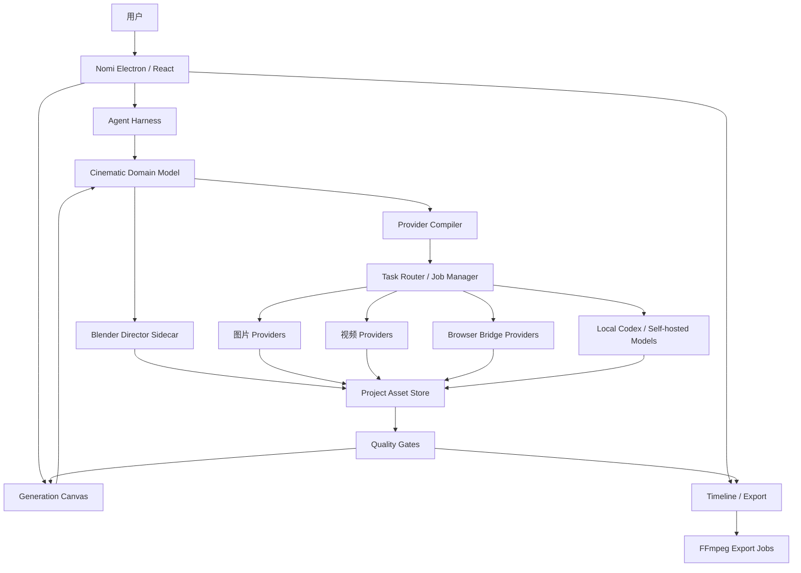

# Nomi 电影级 Agent 创作平台最终目标架构书

日期：2026-08-02  
版本：1.0  
状态：目标架构，尚未全部实现  
适用仓库：`/Users/huawuer/Projects/Nomi-codex-director-upgrade`  
关联资料：

- [电影语言与 AI 视频生成资源地图](../research/2026-08-02-film-and-ai-video-resource-map.md)
- [Nomi Production Video Export Architecture](./nomi-production-video-export-architecture-2026-05-24.md)
- [提交幂等方案](../plan/2026-06-27-submission-idempotency.md)

---

## 1. 本文解决什么问题

本文定义 Nomi 最终要成为的产品、系统边界、组件职责、数据真相源、Agent 权限、模型接入方式、任务状态机、Blender 预演、质量验收、许可边界、性能指标和交付 Gate。

本文不是：

- 功能愿望清单。
- 提示词合集。
- “把若干 GitHub 仓库复制进来”的接入说明。
- 对当前代码完成度的宣传。
- 未经真实 Provider 验收的能力声明。

本文中的“目标态”表示最终必须达到；“现状”表示代码中已经存在但仍可能需要补齐和验证。

---

## 2. 最终产品定义

### 2.1 一句话定义

**Nomi 是一个 local-first 的电影级 AI 创作控制台：用户通过画布组件和 Agent 对话，把剧本变成可审阅的电影分镜、受控参考资产、3D 机位预演、可追溯的图片/视频版本和可导出的时间线。**

### 2.2 核心价值

Nomi 不与单一图像或视频模型竞争。它负责模型通常做不好的部分：

1. 把叙事意图转为结构化镜头语言。
2. 管理跨镜头的角色、场景、道具、服装和空间连续性。
3. 为不同 Provider 选择正确的生成模式和参数。
4. 防止长任务重复提交、重复扣费和结果丢失。
5. 保留所有候选版本、来源、费用和验收结果。
6. 用 Blender 表达可修改的空间关系、机位和运镜。
7. 把通过验收的镜头放入可继续编辑和导出的时间线。

### 2.3 最终用户体验

用户应该可以完成以下完整流程，而不需要理解 Nomi 内部数据格式：

1. 新建项目或导入剧本。
2. 与 Agent 讨论故事、风格、人物和节奏。
3. Agent 提出结构化分镜方案，用户先审阅，再确认落画布。
4. 角色、场景、道具、服装和项目风格形成独立资产卡。
5. 分镜脚本是画布上的中心组件；每行是一条可连接、可生成、可验收的镜头记录。
6. 用户在统一的图片/视频设置面板里选择 Provider、模型、比例、分辨率、时长、参考模式和批量策略。
7. Agent 判断镜头应使用文生、首帧、首尾帧、全能参考、主体参考还是视频参考，并解释原因。
8. 需要空间控制时，镜头发送到 Blender 导演台，用户可在 Blender 中查看和调整真实机位与摆位。
9. 每次生成产生一个新 revision，不覆盖旧结果；用户可以比较、选中、回滚和淘汰。
10. Nomi 自动检查画幅、动态程度、动作完成、人物一致性、镜头语言和连续性。
11. 通过验收的镜头按分镜顺序进入时间线，用户继续剪辑、配音、配乐和导出。

---

## 3. 北极星目标与完成定义

### 3.1 北极星目标

对一个 6–12 镜的短片项目，用户可以只通过 Nomi 画布和 Agent 完成：

```text
剧本 → 分镜 → 资产 → 关键帧 → 视频 → 验收 → 时间线 → MP4
```

过程中每个付费任务可追踪、最多提交一次、可取消、可恢复、可审计；每个生成结果可回退；每个模型调用都来自用户已连接且明确选择的 Provider。

### 3.2 架构级完成定义

只有同时满足以下条件，才能称为“最终目标完成”：

- 一条真实项目旅程从剧本到 MP4 全程跑通。
- 至少一个图片 Provider、两个视频 Provider 和本地 Blender 通过真实验收。
- 每种生成模式都有结构化能力声明，不靠模型名称字符串猜测。
- 相同 `idempotencyKey` 的付费提交在进程内最多执行一次。
- 任务轮询永远不会创建新付费任务。
- 生成 revision 不覆盖旧资产，能够选择和回滚。
- 分镜、资产、生成任务、验收和时间线使用稳定 id 关联。
- Agent 只能调用被 Skill 和当前阶段允许的工具。
- 所有收费写操作和高影响本地修改都有明确确认边界。
- 画布在验收规模下没有不可接受的卡顿、内存持续增长或交互失效。
- Blender、Codex、Chrome/网页桥和 FFmpeg 子进程均有生命周期管理和清理报告。
- 电影参考资料、开源代码、模型权重和 3D 资产均有许可证/来源记录。
- 单测、类型、构建、真实 UI 走查、真实 Provider smoke 和失败恢复全部有本轮证据。

### 3.3 当前基础与缺口

以下是本架构书编写时对当前 checkout 的代码级判断，不等于真实产品验收：

| 领域 | 当前基础 | 目标缺口 |
| --- | --- | --- |
| Skill Runtime | 已支持 Skill 知识注入、阶段和允许工具过滤 | 知识 Skill 仍不能自动获得外部执行能力；需补电影工具和完整 schema |
| Canvas Skill | 已支持 inputs、stages、neededProviders、recipeIds、outputNodeIds 和运行状态 | 需要电影导演专用 UI、ShotSpec 绑定和版本迁移 |
| Storyboard Planner | 已有先提案、用户确认后落画布的边界 | 现有字段不足以承载完整电影语言、动作初尾态、声音和验收标准 |
| Provider Catalog | 已有多 Provider/model catalog 和任务路由 | 能力声明与 Prompt Compiler 尚未统一覆盖所有参考模式 |
| 付费任务 | 已有进程内 Submission Ledger 和 `idempotencyKey` | 需要持久恢复、Provider task ledger、预算和所有入口覆盖证明 |
| 即梦 Web | 已有 bridge、图片/视频任务和状态映射基础 | 需要版本化 UI 适配、四结果选择、参数应用证明和真实页面验收 |
| Blender | 已有声明式 VIBING Director plan、`.blend`/GLB/预览回传和进程取消基础 | 需要 ShotSpec/分镜行闭环、相机 JSON、人工修改继续和真实场景质量验收 |
| Revision | 部分节点/任务已有结果记录 | 尚需统一 AssetRevision、候选比较、selected 指针和无损回滚 |
| 自动验收 | 有零散测试和能力验证 | 尚需四层质量门、证据报告和人工 override |
| 时间线/导出 | 已有时间线和 MP4 导出基础方案 | 生产级 immutable manifest、音频、OTIO、长视频稳定性尚未全部完成 |
| 性能 | 已做过局部卡顿和资源问题修复 | 需要固定基准、heap/trace、200 节点和媒体生命周期的完整报告 |

因此第一步不是再新增孤立功能，而是统一领域模型和现有入口。

---

## 4. 必须做、可以做、不能做

### 4.1 必须做

| 能力 | 必须达到的结果 |
| --- | --- |
| 电影语言结构化 | 镜头信息进入 `ShotSpec`，不能只存在 prompt 文本里 |
| 画布组件化 | Skill 在画布上有真实组件、输入、阶段、状态、输出，不只是菜单项 |
| 分镜中心化 | 分镜表是镜头真相源；资产和生成结果围绕它组织，不重复散落 |
| Agent 可执行 | Skill 必须绑定真实工具；工具有 schema、权限和审计日志 |
| Provider 解耦 | 统一意图由 Provider Compiler 转换，UI 不复制多套 |
| 模型能力发现 | 模型声明真实支持的模式、参数、限制和输入数量 |
| 单次提交 | create 与 poll 分离；同一生成意图不能重复计费 |
| 非破坏 revision | 每次重新生成保留旧结果和费用记录 |
| 参考图语义 | 每张参考图必须声明用途，禁止无语义图片数组 |
| Blender 回传 | `.blend`、相机、预览和 GLB 回到项目，并保留来源 |
| 自动验收 | 至少覆盖技术质量、动作完成、连续性和动态程度 |
| 时间线交换 | 分镜与时间线通过稳定 manifest/OTIO 映射 |
| 安全与隐私 | Key/Cookie 不进入 renderer、日志、prompt 或导出包 |
| 许可审计 | 代码、模型、数据、电影参考和 3D 资产分别记录条款 |

### 4.2 可以做，但必须后置或受约束

| 能力 | 条件 |
| --- | --- |
| 自动批量生成 | 用户确认范围、预算、并发和模型后才能开始 |
| 自动重试 | 只允许免费查询/下载重试；不允许未知状态下再次付费提交 |
| 联网检索电影参考 | 只保存元数据、链接和用户授权副本，不镜像受版权保护图库 |
| 自动下载 3D 资产 | 仅允许许可证明确、来源可记录、用户确认的连接器 |
| 自托管开放视频模型 | 作为可选 Provider；必须声明硬件、许可证和输出限制 |
| 多 Agent 协作 | Agent 必须职责单一、共享结构化项目状态，不靠互相转发长对话 |
| 自动选择模型 | 只能在用户已连接和预算允许的模型中推荐，最终选择可被用户覆盖 |
| VLM 自动验收 | 可自动给建议和分数，但不能无证据删除用户资产 |
| 导演风格模板 | 必须拆成可观察电影属性，不只使用导演姓名 |

### 4.3 明确不能做

| 禁止项 | 原因 |
| --- | --- |
| 把 Skill 当成真实执行能力 | 当前 Skill 文本本身不会执行外部 CLI/HTTP/文件操作 |
| 轮询超时后重新 create | 会导致重复扣费 |
| 覆盖旧生成结果 | 用户无法回滚，且破坏审计 |
| Agent 绕过确认直接花费 | 预算和生成范围失控 |
| 把图片模型和视频模型嫁接错 | 生成类型和能力必须由结构化 catalog 决定 |
| 用模型显示名判断能力 | 显示名会变化，且不同 Provider 可能重名 |
| 在 renderer 暴露 API Key/Cookie | 安全边界错误 |
| 批量抓取 ShotDeck/电影帧/付费课程 | 版权和服务条款风险 |
| 声称能精确复制某导演 | 不可验证，也可能涉及风格和平台政策问题 |
| 把 README、mock 或历史日志写成真实验收 | 不能证明当前产品可用 |
| 用 Three.js 假预览冒充 Blender 场景 | 物体关系和真实工程不可编辑 |
| Agent 输出 Blender Python/shell 并直接执行 | 权限过大、不可审计 |
| 自动安装来历不明模型或插件 | 供应链、许可证和安全风险 |
| 承诺生成模型必然保持人物/物理一致 | 生成模型有随机性，只能通过参考、版本和验收降低风险 |
| 把 Nomi 做成完整 Blender/DaVinci 替代品 | 超出 solo 产品的可维护边界 |

---

## 5. 核心架构原则

### P1. 一个镜头真相源

`ShotSpec` 是镜头意图的唯一真相源。图片 prompt、视频 prompt、Blender 相机、Provider 参数和验收规则都从它派生，不互相复制为独立真相。

### P2. 意图与执行分离

用户表达“要什么”，`GenerationIntent` 记录模型无关意图；Provider Compiler 决定“怎么调用”。更换 Provider 不应重写分镜。

### P3. 规划免费可改，执行确认才花费

Agent 可以自由分析、建议和生成结构化方案；触发收费 Provider 或高影响本地修改前必须形成可审阅计划并确认。

### P4. 所有生成都是 revision

重新生成不叫覆盖，而是创建新 revision。当前选中版本只是一个指针。

### P5. 长任务是持久 job

生成、下载、Blender、评测和导出都是 job，必须有 id、状态、时间、日志、取消和恢复。

### P6. Provider 只是可替换执行器

画布、分镜和 Agent 不依赖某个服务商名称。Provider 必须通过能力声明和 adapter 接入。

### P7. local-first，但不假装所有模型都能本机跑

项目状态、素材索引、任务台账、Blender 工程和导出保存在本地。大型生成模型可以是云端 Provider，但必须明确上传内容和费用。

### P8. 最小权限

Skill 声明允许工具；Agent 只看到当前阶段所需工具；renderer 不持有密钥；Blender 只执行受约束计划。

### P9. 自动验收不能替代人类决策

自动验收用于发现问题、排序候选和阻止明显技术错误；最终创作选择由用户决定。

### P10. 证据优先

“已接入”需要真实 UI、真实任务、真实资产回写和清理证据。测试绿只证明代码健康。

---

## 6. 系统上下文



---

## 7. 分层架构

### 7.1 体验层

- 项目库。
- 创作区和 Agent 对话。
- 生成画布。
- 电影导演组件。
- 分镜脚本组件。
- 角色/场景/道具/服装/风格资产组件。
- Blender Director 回传节点。
- 图片/视频统一设置面板。
- 任务中心和成本视图。
- 时间线、预览、导出。

### 7.2 领域层

- `FilmBible`
- `NarrativeBeat`
- `ShotSpec`
- `ContinuityConstraint`
- `ReferenceBinding`
- `GenerationIntent`
- `AssetRecord`
- `AssetRevision`
- `ProviderTask`
- `EvaluationReport`
- `TimelineManifest`

### 7.3 编排层

- Storyboard Planner。
- Cinematic Director Agent。
- Reference Planner。
- Provider Compiler。
- Generation Orchestrator。
- Dependency Scheduler。
- Blender Plan Orchestrator。
- Evaluation Orchestrator。
- Timeline Assembler。

### 7.4 基础设施层

- Electron main process。
- 受限 IPC。
- 本地项目存储。
- Provider adapters/catalog。
- Submission Ledger。
- Chrome/即梦 Web bridge。
- Codex Img2 runner。
- Blender sidecar。
- FFmpeg/export jobs。
- OpenTimelineIO adapter。
- OpenColorIO/ACES 配置。
- 结构化日志、trace 和成本台账。

---

## 8. 画布信息架构

### 8.1 项目级组件

#### Film Bible

保存跨项目镜头都应遵守的事实：

- 故事主题和受众。
- 时代、地点和世界规则。
- 画幅、帧率、目标时长。
- 摄影与色彩策略。
- 角色身份和关系。
- 场景空间关系。
- 道具归属与状态。
- 服装变化。
- 音乐、环境声和对白原则。
- 禁止出现的内容。

Film Bible 不能保存 API Key、Cookie、模型私有配置或长篇聊天记录。

#### Asset Registry

管理角色、场景、道具、服装、风格、图片、视频、音频和 3D 资产。每个资产有稳定 id、来源、许可证、哈希、尺寸、选中 revision 和使用关系。

### 8.2 分镜脚本组件

分镜脚本是镜头中心视图。每行对应一个 `ShotSpec`，最少展示：

- 镜号。
- 叙事节拍。
- 景别/机位/焦段。
- 运镜。
- 角色与表演。
- 场景/道具。
- 对白/声音。
- 图片提示词和选中预览。
- 视频提示词和选中预览。
- 状态与验收结果。

复杂字段通过列显隐和行详情编辑，不把所有控制永久铺在表格中。

每行提供稳定端口：

- 图片输入/输出。
- 视频输入/输出。
- 参考资产输入。
- Blender 预演输入/输出。
- 时间线输出。

收纳模式下，端口和连线聚合到分镜组件，角色/场景/道具层的内部引用线不在主画布展开。

### 8.3 电影导演组件

这是用户与 Cinematic Director Agent 的主要入口，包含：

- 当前项目/选中镜头上下文。
- Agent 对话。
- 待确认结构化变更。
- 电影语言检查。
- Provider 生成建议。
- Blender 预演动作。
- 最近任务和验收摘要。

它不是第二份分镜表，也不复制资产库。它通过稳定 id 读取和修改领域对象。

### 8.4 统一生成设置

图片设置和视频设置必须脱离表格行，使用项目级/批次级面板：

- Provider。
- 模型。
- 生成模式。
- 画幅、分辨率、时长、帧率。
- 生成数量。
- 参考图用途映射。
- 并发和预算。
- 是否沿用逐镜 override。

优先级：

```text
本次批次显式设置 > 镜头 override > 项目默认 > 模型默认
```

---

## 9. 核心数据模型

### 9.1 ShotSpec v1

```ts
export type ShotSpecV1 = {
  version: 1
  id: string
  projectId: string
  sceneId: string
  index: number
  title: string

  narrative: {
    intent: string
    beat: string
    conflict?: string
    informationRevealed?: string[]
  }

  time: {
    durationSeconds: number
    startState: string
    endState: string
  }

  subjects: Array<{
    assetId: string
    role: 'primary' | 'secondary' | 'background'
    performance?: string
    dialogue?: string
  }>

  environment: {
    sceneAssetId?: string
    propAssetIds: string[]
    costumeAssetIds: string[]
    spatialRelations: string[]
  }

  cinematography: {
    shotScale: string
    cameraAngle: string
    lensMm?: number
    apertureIntent?: string
    cameraMotion: {
      type: string
      direction?: string
      amount?: string
      speed?: string
    }
    composition: string
    blocking: string
    screenDirection?: string
    lighting: string
    color: string
  }

  actionChain: string[]
  sound: {
    dialogue?: string
    ambience?: string
    sfx: string[]
    musicIntent?: string
  }

  continuity: Array<{
    kind: 'identity' | 'costume' | 'prop-state' | 'screen-direction' | 'space' | 'time' | 'light'
    rule: string
    sourceShotId?: string
  }>

  references: ReferenceBinding[]
  generationStrategy: GenerationStrategy
  acceptanceCriteria: string[]
  selectedImageRevisionId?: string
  selectedVideoRevisionId?: string
  status: ShotStatus
}
```

### 9.2 ReferenceBinding

```ts
export type ReferenceBinding = {
  assetId: string
  revisionId?: string
  role:
    | 'identity'
    | 'character'
    | 'scene'
    | 'prop'
    | 'costume'
    | 'style'
    | 'composition'
    | 'first-frame'
    | 'last-frame'
    | 'motion'
    | 'video-reference'
  strength?: number
  required: boolean
}
```

规则：不能向 Provider 发送没有 `role` 的图片数组。Provider 不支持某类 reference 时，Compiler 必须明确降级或阻止，不能静默丢弃。

### 9.3 GenerationStrategy

```ts
export type GenerationStrategy = {
  mediaKind: 'image' | 'video'
  mode:
    | 'text-to-image'
    | 'image-to-image'
    | 'text-to-video'
    | 'first-frame'
    | 'first-last-frame'
    | 'omni-reference'
    | 'subject-reference'
    | 'video-reference'
    | 'video-extension'
  rationale: string
  providerId?: string
  modelKey?: string
  overrides?: Record<string, unknown>
}
```

### 9.4 ProviderCapabilities

```ts
export type ProviderCapabilities = {
  providerId: string
  modelKey: string
  mediaKind: 'image' | 'video' | 'model3d' | 'audio'
  modes: string[]
  referenceRoles: string[]
  maxReferences: number
  maxOutputs: number
  aspectRatios: string[]
  resolutions: string[]
  durationsSeconds: number[]
  supportsSeed: boolean
  supportsNegativePrompt: boolean
  supportsCallback: boolean
  supportsCancel: boolean
  supportsProviderIdempotency: boolean
  async: boolean
  parametersSchema: Record<string, unknown>
  source: 'official-api' | 'browser-bridge' | 'local-runtime'
  verifiedAt: string
}
```

### 9.5 GenerationIntent 与 ProviderRequest

```ts
export type GenerationIntent = {
  id: string
  projectId: string
  shotId?: string
  mediaKind: 'image' | 'video'
  prompt: string
  negativePrompt?: string
  references: ReferenceBinding[]
  target: {
    aspectRatio: string
    resolution?: string
    durationSeconds?: number
    outputCount: number
  }
  budget: {
    maxCostCny?: number
    maxSubmissions: number
  }
}

export type CompiledProviderRequest = {
  intentId: string
  providerId: string
  modelKey: string
  modeId: string
  idempotencyKey: string
  requestBody: unknown
  compilationWarnings: string[]
}
```

### 9.6 AssetRevision

```ts
export type AssetRevision = {
  id: string
  assetId: string
  parentRevisionId?: string
  kind: 'imported' | 'generated' | 'edited' | 'blender-preview' | 'exported'
  localPath: string
  sha256: string
  mimeType: string
  width?: number
  height?: number
  durationSeconds?: number
  providerTaskId?: string
  promptSnapshot?: string
  requestSnapshotPath?: string
  evaluationReportId?: string
  costCny?: number
  createdAt: string
  status: 'candidate' | 'selected' | 'rejected' | 'archived'
}
```

---

## 10. 状态机

### 10.1 镜头状态

```text
draft
  → planned
  → asset-blocked | ready
  → generating
  → candidate-ready
  → evaluating
  → needs-revision | accepted
  → placed-on-timeline
```

约束：

- 缺少 required reference 时不能进入 `ready`。
- `generating` 只能由持久任务驱动，不能由 UI 临时 loading 驱动。
- `accepted` 必须指向选中的 revision 和验收报告。
- 用户可手动接受带警告结果，但必须记录 override 原因。

### 10.2 Provider 任务状态

```ts
type ProviderTaskStatus =
  | 'created-local'
  | 'awaiting-confirmation'
  | 'submitting'
  | 'submitted'
  | 'queued'
  | 'running'
  | 'downloading'
  | 'succeeded'
  | 'failed'
  | 'cancelled'
  | 'unknown'
```

核心不变量：

1. `submitting` 只允许一次进入真实 create 内核。
2. `submitted` 后只允许查询、回调、下载和取消。
3. `unknown` 不能自动重新提交。
4. 用户点击“重新生成”创建新的 `GenerationIntent.id` 和 revision 分支。
5. 失败任务不能伪装为未开始。

### 10.3 Skill Playbook 状态

沿用：

```text
ready → running → awaiting-confirm → ready → done
                    └──────────────→ error
```

每个阶段声明允许工具；旧响应不能推进新的 run。

---

## 11. Agent Harness

### 11.1 Agent 不是聊天皮肤

真实 Agent 能力由四部分共同构成：

```text
Skill 方法论 + 结构化上下文 + 允许工具 + 验收器
```

缺少任何一个，都不能称为可执行 Skill。

### 11.2 计划工具集

#### 只读工具

- `read_project_summary`
- `read_film_bible`
- `read_storyboard`
- `read_shot_spec`
- `read_asset_registry`
- `read_provider_capabilities`
- `read_task_status`
- `read_evaluation_report`
- `read_vibing_director_state`

#### 提案工具

- `propose_film_bible_patch`
- `propose_storyboard_plan`
- `propose_shot_patch`
- `propose_generation_plan`
- `propose_timeline_assembly`

提案只生成结构化草案，不改画布、不花费。

#### 本地修改工具

- `apply_film_bible_patch`
- `apply_storyboard_patch`
- `create_asset_records`
- `select_asset_revision`
- `archive_asset_revision`
- `apply_vibing_director_plan`
- `place_assets_on_timeline`

#### 付费/外部工具

- `submit_generation_intent`
- `cancel_provider_task`
- `download_provider_result`
- `run_optional_gpu_evaluation`

### 11.3 权限矩阵

| 操作 | 默认 | 是否确认 | 是否记录审计 |
| --- | --- | --- | --- |
| 读取项目 | 允许 | 否 | trace 摘要 |
| 生成分镜提案 | 允许 | 否 | 是 |
| 修改 prompt 草稿 | 允许 | 低风险可撤销时不确认 | 是 |
| 创建/删除/连线画布节点 | 禁止自动 | 是 | 是 |
| 切换 selected revision | 允许建议 | 是 | 是 |
| 调用收费 Provider | 禁止自动 | 是，批次授权可覆盖多镜 | 是，含预计/实际费用 |
| 重新提交未知任务 | 禁止 | 必须由用户新建生成 | 是 |
| 执行 Blender 计划 | 禁止自动 | 是 | 是 |
| 打开本地文件/Blender | 用户命令 | 是 | 是 |
| 下载外部资产 | 禁止默认 | 是且需许可证 | 是 |
| 删除本地资产 | 禁止自动 | 是 | 是 |

### 11.4 上下文与压缩

Agent 不依赖无限聊天上下文。持久事实写入领域对象：

- Film Bible 保存项目级事实。
- ShotSpec 保存镜头事实。
- Asset Registry 保存身份和来源。
- Task Ledger 保存执行事实。
- Evaluation Report 保存质量事实。

上下文压缩只总结对话决策和未解决问题，不重写这些真相源。压缩后 Agent 必须重新读取当前对象，不能依赖旧摘要猜测。

### 11.5 Agent 输出约束

- 所有修改通过 JSON Schema 工具参数。
- 不接受“兼容协议返回一段看起来像 JSON 的文本”直接执行。
- 解析失败时保留原状态并显示错误，不做部分写入。
- 工具调用必须包含目标稳定 id。
- Agent 不能声称已执行未调用的工具。

---

## 12. Provider 接入架构

### 12.1 接口分层

```text
Provider Catalog
  定义模型身份、模式、参数和限制

Provider Compiler
  ShotSpec/GenerationIntent → model-specific request

Provider Adapter
  鉴权、create、query、cancel、download

Task Router
  幂等、并发、预算、状态、恢复、清理
```

### 12.2 Adapter 合约

每个 Adapter 必须实现或明确声明不支持：

```ts
interface ProviderAdapter {
  compile(intent: GenerationIntent, capabilities: ProviderCapabilities): CompiledProviderRequest
  submit(request: CompiledProviderRequest): Promise<{ providerTaskId: string }>
  query(providerTaskId: string): Promise<ProviderTaskSnapshot>
  cancel?(providerTaskId: string): Promise<void>
  download(result: ProviderResult): Promise<DownloadedAsset[]>
}
```

禁止 Adapter 把“查询无结果”转换成新的 `submit`。

### 12.3 模型选择

模型下拉只显示：

- 当前已连接 Provider。
- 当前任务 media kind 相符。
- 当前生成模式相符。
- 所需参考数量和参数受支持。
- 当前地区/账号实际可用。

保存自定义 Provider 后，catalog refresh 必须使模型立即进入正确下拉，无需重启。若探测失败，显示连接错误，不添加幽灵模型。

### 12.4 第一批真实适配

优先顺序：

1. Codex Img2：图片生成和参考图编辑。
2. 即梦 Web：图片和 Seedance 视频网页桥。
3. AGNES：视频 API，修正图片 URL/单图/数组映射。
4. 已连接的火山方舟、智谱、Kimi/MiniMax Agent Provider。
5. 其他官方 API：Veo、Sora、Luma、MiniMax Video、Vidu。

开放模型先作为外部/self-hosted Provider 接入，不把大权重打包进 Nomi。

---

## 13. 即梦 Web / Browser Bridge 特殊约束

浏览器桥不是稳定官方 API，必须按 UI automation 风险设计。

### 13.1 必须具备

- 固定扩展版本和站点适配版本。
- 页面/标签识别，不依赖用户当前视觉焦点。
- create 成功后记录网页任务 id、模型、参数、提交时间和页面实例。
- 只提交一次；等待时间长时只查询状态。
- 页面跳转或控件定位失败时进入可恢复错误，不重复生成。
- 即梦一次返回四张时，全部拉回候选，用户选择一张；不能默认丢弃三张。
- 图片/视频拉回本地后计算哈希，防止重复导入。
- Cookie 只保存在受控浏览器 profile，不进入 Nomi 日志。

### 13.2 明确禁止

- 未确认参数已经应用就点击生成。
- 参数控件找不到后使用旧值静默提交。
- 因拉取超时再次点击生成。
- 同时由侧栏和主页镜像控件各提交一次。
- 把网页积分当作无限额度。
- 把网页自动化称作官方 API。

---

## 14. Blender Director 架构

### 14.1 定位

Blender 是独立、可编辑的 3D 导演台；Nomi 节点负责对话、计划、状态和产物回传，不在 Canvas 中重新实现完整 3D 编辑器。

### 14.2 输入

- Film Bible 场景事实。
- ShotSpec 的 blocking、camera、lens、motion 和 beats。
- 已授权资产库中的稳定 `assetId`。
- 用户确认的声明式 Blender plan。

### 14.3 输出

- `.blend` 工程。
- `.glb` 场景或选中对象。
- 相机 JSON：位置、旋转、焦段、传感器、路径和关键帧。
- 预览图片。
- 低码率预演视频。
- 物体关系和资产来源快照。

### 14.4 执行边界

- Agent 只提交允许 action 的声明式 plan。
- Blender runner 负责验证路径、资产 id、action 和输出目录。
- 禁止 Agent 任意执行 Python、shell、网络下载或读取项目外文件。
- Blender 子进程完成、失败、取消或 Nomi 退出时必须清理。
- 用户在 Blender 内人工修改后，Nomi 读取新的工程摘要，不覆盖人工变更。

### 14.5 与视频模型的连接

- 商业模型不支持轨迹时：将相机参数编译成明确镜头语言，并提供 Blender 渲染参考。
- 支持首尾帧时：从 Blender 渲染首/尾关键帧。
- 支持视频参考时：使用低模预演视频作为 motion reference。
- 支持相机轨迹的自托管模型时：传真实 camera trajectory。

不能承诺所有 Provider 都会精确遵循 Blender 轨迹；能力必须按模型声明。

---

## 15. 提示词编译体系

### 15.1 Prompt 不是唯一真相源

Prompt 是 `ShotSpec + FilmBible + references + provider capabilities` 的派生产物。

### 15.2 图片 Prompt 编译

顺序建议：

```text
主体身份与数量
→ 场景和空间关系
→ 当前瞬间动作/姿态/表情
→ 景别/机位/焦段/构图
→ 光线/色彩/材质
→ 参考图用途
→ 排除项
```

图片 prompt 禁止描述不可见的时间过程。手机背面朝向镜头时，不能同时描述屏幕内容可见。

### 15.3 视频 Prompt 编译

顺序建议：

```text
镜头叙事目的
→ 起始可见状态
→ 主体动作链
→ 动作结果/结束状态
→ 相机运动轴、方向、速度
→ 表演节奏
→ 光影随动作/运镜变化
→ 连续性锁定
→ 参考图角色声明
→ 声音/对白（模型支持时）
```

禁止只复制图片 prompt。视频 prompt 必须包含动作演进和结果。

### 15.4 生成模式选择规则

| 镜头需求 | 默认模式 |
| --- | --- |
| 无既有视觉资产、构图自由 | T2V/T2I |
| 角色/场景身份一致，但需要较大运动自由 | 全能/主体参考 |
| 必须从上一镜接戏 | 首帧 |
| 明确位移、状态变化和结果 | 首尾帧 |
| 已有动作/运镜示例 | 视频参考 |
| 只修改外观、保持构图 | I2I/V2V 编辑 |

模式选择由规则和 Provider 能力共同决定，Agent 给出理由，用户可以覆盖。

---

## 16. 依赖调度与批量生成

### 16.1 依赖图

每个任务声明输入资产和输出资产：

```text
角色/场景/道具参考图
  → 镜头关键帧
    → 尾帧或视频参考
      → 视频
        → 验收
          → 时间线
```

Scheduler 只能并行没有依赖关系且预算允许的任务。

### 16.2 默认策略

- 默认并发上限 2。
- 同一网页桥 Provider 可进一步限制为 1。
- 失败不自动重新付费提交。
- 一个任务完成后释放运行槽，但保留任务记录。
- 子进程完成后销毁；诊断目录按保留策略清理。
- 批量面板必须显示预计提交数、预计费用、依赖阻塞和已存在结果。

### 16.3 批量生成覆盖规则

用户在批量面板显式选择的设置覆盖逐镜默认；没有显式设置的字段才回落到镜头/project/model 默认。UI 必须显示最终 resolved 配置，避免用户以为已覆盖但实际沿用旧参数。

---

## 17. Revision、回滚与候选管理

### 17.1 不覆盖原则

同一镜头第 2、3 次生成创建：

```text
shot-07
  image-r1
  image-r2  ← selected
  image-r3
  video-r1
  video-r2  ← selected
```

### 17.2 必须支持

- 候选网格比较。
- 双击全屏图片/视频预览。
- 实际分辨率、画幅、时长和文件大小显示。
- 选为当前版本。
- 从当前版本派生编辑。
- 回滚 selected 指针。
- 归档失败/不满意版本。
- 查看 prompt、模型、参数、参考图、费用、耗时和验收报告。

### 17.3 删除策略

默认归档，不立即物理删除。物理清理必须检查没有节点、时间线、revision 或导出引用，并要求确认。

---

## 18. 自动验收架构

### 18.1 四层质量门

#### Gate A：请求前检查

- 模型和媒体类型匹配。
- 生成模式受支持。
- 参考数量和用途合法。
- 图片可被 Provider 访问或已正确上传。
- 画幅、分辨率、时长和参数取值合法。
- 预算和并发未超限。
- Prompt 不包含明显空间矛盾。

#### Gate B：技术质量

- 文件存在且非空。
- MIME、容器和 codec 可读取。
- 实际画幅/分辨率/时长符合请求。
- 无全黑、全白、损坏、严重冻结或重复文件。
- 视频有预期音轨时确实存在音轨。

#### Gate C：语义与电影技法

- 人物、服装、道具、场景是否正确。
- 动作链和结束状态是否发生。
- 景别、角度、构图、运镜、光线和色彩是否符合。
- 是否出现“动态图片感”。
- 手机、文字、肢体、空间方向是否违反镜头事实。

#### Gate D：跨镜连续性

- 身份、服装、道具状态。
- 屏幕方向和视线。
- 场景空间关系。
- 时间、天气和光线。
- 上一镜尾帧到下一镜首帧。
- 声音和对白连续性。

### 18.2 评分输出

```ts
type EvaluationReport = {
  verdict: 'pass' | 'warn' | 'fail'
  technical: Record<string, number | boolean | string>
  semantic: Array<{ criterion: string; score: number; evidence: string }>
  cinematic: Array<{ dimension: string; score: number; evidence: string }>
  continuity: Array<{ rule: string; status: 'pass' | 'warn' | 'fail'; evidence: string }>
  recommendedAction?: string
  evaluatorVersions: string[]
}
```

自动验收必须保存证据和 evaluator 版本，不能只给一个不可解释总分。

---

## 19. 时间线与导出

### 19.1 时间线输入

只有选中的、可读取的 asset revision 可以进入时间线。镜头到 clip 的映射保存 `shotId` 和 `revisionId`。

### 19.2 OpenTimelineIO

使用 OpenTimelineIO 作为跨编辑工具交换层：

- Nomi 内部 timeline model 保持适合 UI 编辑。
- 导入/导出 OTIO 时转换 clips、tracks、markers 和 metadata。
- Provider task、prompt 和验收信息作为 metadata，不嵌入媒体内容。

### 19.3 导出

沿用独立生产导出架构：

```text
immutable render manifest
→ export job
→ planner
→ FFmpeg/headless renderer
→ atomic MP4
```

不能让 React 页面直接承担最终长视频导出。

---

## 20. 项目存储结构

建议目标结构：

```text
project/
  project.json
  film-bible.json
  storyboard.json
  assets/
    registry.json
    image/
    video/
    audio/
    model3d/
  revisions/
    <asset-id>/
      <revision-id>/
        metadata.json
        request.json
        result.*
  director/
    <director-node-id>/
      scene.blend
      scene.glb
      camera.json
      preview.png
      preview.mp4
  tasks/
    ledger.jsonl
    traces/
  evaluations/
  timeline/
    timeline.json
    project.otio
  cache/
  exports/
```

要求：

- 资产使用相对项目路径和稳定 id。
- 外部 URL 下载后再进入正式资产。
- 临时 URL 不能成为项目长期依赖。
- 项目删除前可导出可迁移包。
- 缓存可清理，正式资产和 revision 不可被缓存清理误删。

---

## 21. 性能与资源预算

### 21.1 画布

验收规模：

- 200 个节点。
- 400 条逻辑连接。
- 12 镜分镜表，每镜至少 3 个资产引用和图片/视频 revision。

标准：

- 拖动、缩放、框选不发网络请求。
- 不可见图片和视频不持续解码。
- 视频缩略图默认不自动播放。
- 连线和节点派生数据使用 memoized selector，不订阅全量 store。
- 聚合/收纳后隐藏内部关系线。
- 连续拖动 60 秒后不能出现输入失效或全画布锁死。

### 21.2 内存

标准：

- 30 次图片拖入、预览、删除/归档循环后，GC 后内存不能持续线性增长。
- 打开/关闭 Director、全屏预览和设置面板不能累积事件监听器。
- 生成完成后 Codex/Blender/FFmpeg 子进程归零。
- Chrome/即梦 Web 使用一个受控持久 profile，不为每次任务创建浏览器实例。
- 关闭项目后释放视频元素、object URL、canvas texture 和 worker。

### 21.3 任务

- 默认全局生成并发 2。
- Provider 可声明更低并发和最小查询间隔。
- 轮询在 main process/job worker，不在 React render loop。
- Agent 流式状态和任务事件有背压，不向 UI 高频发送大对象。

### 21.4 性能验收证据

- Electron/Chrome Performance trace。
- heap snapshot 前后对比。
- 进程树与 RSS 采样。
- 200 节点 Playwright 真实交互录屏/截图。
- 任务完成和退出后的孤儿进程检查。

### 21.5 可量化 SLO

这些数值是目标验收线；测试必须记录机器型号、系统版本、Nomi build、项目 fixture 和采样方法。

| 指标 | 目标 |
| --- | --- |
| 画布交互 | 200 节点/400 逻辑边 fixture 下，拖动/缩放/框选输入响应 p95 ≤ 50ms |
| 长任务 | 连续交互 60 秒，主线程 >100ms long task 为 0；>50ms 不超过 5 次 |
| 画布稳定 | 导入 30 张图片并反复拖动后，手势、节点拖动和框选成功率 100% |
| 内存回收 | 30 次导入/预览/归档循环并 GC 后，heap 相对稳定基线增长 ≤20%，且后 10 次无单调上升趋势 |
| 面板生命周期 | Director/设置/全屏预览各开关 100 次，无重复事件监听、重复订阅和遗留媒体解码 |
| 子进程清理 | 任务成功、失败、取消和应用退出后 10 秒内，任务创建的 Codex/Blender/FFmpeg 进程回到基线 |
| 付费幂等 | 双击、控制器重试、回执丢失 fixture 中，同一 `idempotencyKey` 真实 create 次数恒为 1 |
| 任务恢复 | Nomi 重启后 10 秒内恢复持久 `submitted/queued/running/unknown` 任务，不创建新任务 |
| 结果去重 | 相同文件哈希不会生成重复正式 revision；多个不同候选不得被误合并 |
| 错误可行动性 | 100% 生成错误显示阶段、Provider、模型、提交状态、可能计费与下一步，且无凭据 |
| 技术验收 | 损坏、空文件、错误画幅、错误时长、黑/白帧 fixture 检出率 100% |
| 动态图片检测 | 固定人工标注 fixture 上 precision 和 recall 均 ≥90% |
| 连续性检查 | 固定身份/服装/道具/屏幕方向错误集上检出率 ≥85%，所有判断带证据 |
| OTIO | 固定 timeline fixture 导出再导入，clip 顺序、时长、轨道和 revision 关联 100% 保留 |
| 导出 | 12 镜 9:16 1080p 含音频项目连续导出 3 次均可播放、尺寸正确、无临时文件残留 |

未达到 SLO 时必须报告实际值和瓶颈，不得将“功能能点”写成性能通过。

---

## 22. 安全、隐私和许可证

### 22.1 凭据

- API Key 存在系统 keychain 或受控主进程配置。
- Cookie 存在专用浏览器 profile。
- renderer 只能使用 opaque provider connection id。
- 日志、trace、错误、prompt snapshot 和项目导出都不能包含密钥或 Cookie。

### 22.2 文件系统

- 所有 IPC 文件操作使用 project-relative path 或受授权 file handle。
- 拒绝 path traversal、symlink escape 和项目外回传。
- Blender/FFmpeg/Codex 输出必须位于任务隔离目录或项目目录。
- 下载文件校验 MIME、大小、扩展名和哈希。

### 22.3 网络

- Provider 域名 allowlist 与 adapter 绑定。
- Browser bridge 只连接明确本地端口和目标站点。
- Agent 不能构造任意 URL 交给高权限 runner。

### 22.4 许可证分类

每项资源分别审计：

1. 源代码许可证。
2. 模型权重许可证。
3. 训练/评测数据许可证。
4. 生成内容平台条款。
5. 电影帧/音频/字体版权。
6. 3D 资产许可证。

“GitHub 可见”“可下载”“开源”“可商用”不是同义词。

### 22.5 第三方资源接入策略

| 类型 | 策略 |
| --- | --- |
| OpenTimelineIO/Fountain/OpenColorIO | 许可证通过后可直接依赖或适配 |
| FFmpeg | 根据构建配置审计 LGPL/GPL，并保留 notice/source 要求 |
| ViMax/Jellyfish/DirectorsConsole | 先作为架构参考；复制代码前逐仓审计 |
| MovieNet/CineTechBench/VBench | 用于研究/评测；数据和电影素材单独审计 |
| ShotDeck/SHOT.CAFE/Frame Set | 外链和人工选择；不批量镜像 |
| 开放视频模型 | adapter、代码和权重分别审计；不默认打包 |

---

## 23. 可观测性与成本治理

### 23.1 关联 id

每次执行至少关联：

```text
projectId
shotId
intentId
idempotencyKey
providerTaskId
assetId
revisionId
agentRunId
traceId
```

### 23.2 任务时间点

记录：

- 计划完成。
- 用户确认。
- 提交开始/回执收到。
- Provider queued/running/completed。
- 下载开始/完成。
- 本地导入完成。
- 验收开始/完成。
- 子进程退出和清理。

### 23.3 成本

- 提交前显示预计提交数和费用上限。
- 提交后记录实际费用或“Provider 未返回费用”。
- 失败、取消和未知状态分别统计。
- 批量任务达到预算上限立即停止新提交，已有任务继续查询。
- 不以重试次数掩盖实际提交次数。

### 23.4 日志边界

- 不记录密钥、Cookie、完整授权头。
- 默认不记录用户本地文件内容。
- prompt snapshot 只保存在项目任务目录，不进入全局遥测。
- 用户可以导出诊断包，诊断包生成时再次脱敏。

---

## 24. 错误模型

错误必须分类，不用一个“Provider request failed”覆盖全部情况：

| 类别 | 例子 | 用户行动 |
| --- | --- | --- |
| authentication | 401、Cookie 失效 | 重新连接账号 |
| authorization | 模型/区域/会员不可用 | 切换可用模型或账号 |
| validation | 图片数组/字符串类型错误、参数不支持 | 修正配置，不提交 |
| quota | 积分、速率、并发上限 | 等待或调整预算 |
| submission-unknown | 请求可能已发出但回执丢失 | 只查询/人工核对，不自动重发 |
| provider-running | 长任务仍进行 | 继续等待，不创建新任务 |
| download | 临时 URL 超时或不可访问 | 只重试下载，不重生成 |
| bridge-ui | 页面结构变化、控件定位失败 | 停止提交并提示更新适配器 |
| local-runtime | Codex/Blender/FFmpeg 启动失败 | 查看诊断目录和本机依赖 |
| evaluation | 结果不满足镜头标准 | 保留候选，建议新 revision |
| cleanup | 孤儿进程/临时文件未清理 | 自动清理并报告 |

错误信息必须包含：阶段、Provider、模型、任务 id、是否已提交、是否可能计费、可执行下一步。不得显示密钥。

---

## 25. 测试策略

### 25.1 单元测试

- ShotSpec schema 和迁移。
- Provider capabilities 过滤。
- Prompt Compiler golden cases。
- ReferenceBinding 映射。
- 依赖图和并发调度。
- Submission Ledger 成功/失败/未知重放。
- Revision 选择和回滚。
- 路径和许可证校验。
- 自动验收规则。

### 25.2 合约测试

- 每个 Provider adapter 的 create/query/cancel/download schema。
- 官方 API 示例的 fixture。
- Browser bridge 消息协议和任务状态。
- Blender plan schema 和输出 envelope。
- OpenTimelineIO 导入/导出 round trip。

### 25.3 集成测试

- Storyboard proposal → 用户确认 → 画布。
- Anchor/asset dependency → keyframe → video。
- 同幂等键双提交只创建一个任务。
- 下载失败只重试下载。
- Nomi 重启后恢复 submitted/running task。
- Blender plan → `.blend`/preview/GLB 回写。
- revision 生成、比较、选择、回滚。
- selected video → timeline → export manifest。

### 25.4 E2E

真实用户旅程：

1. 导入短剧本。
2. Agent 拆 6 镜并审阅。
3. 落画布并创建资产卡。
4. 生成至少一个图片镜头和一个视频镜头。
5. 打开全屏预览并选择 revision。
6. 发送一个镜头到 Blender 并回传预览。
7. 将镜头放入时间线。
8. 导出 MP4。

### 25.5 真实 Provider 验收

- 必须是隔离测试项目。
- 明确提交上限、并发上限和费用上限。
- 失败默认不自动重新付费提交。
- 报告请求数、成功数、失败数、费用、耗时、资产路径和清理。
- 不修改日常项目。
- 不输出凭据和 Cookie。

---

## 26. 审查标准

### 26.1 六角色架构审查

#### CTO / 架构

- 是否只有一个领域真相源。
- 是否出现 Provider 特例渗入 UI/领域层。
- 是否存在平行旧实现、隐藏 fallback 或巨壳模块。
- 状态机、恢复、回滚和迁移是否完整。
- 是否能在不重写画布的情况下新增 Provider。

#### 产品

- 是否解决用户真实工作流，而不是展示技术。
- 用户是否能看懂当前镜头、当前版本、当前模型和是否会花费。
- 自动化是否减少逐镜重复配置。
- 是否诚实呈现模型限制和失败。
- 是否避免把 Nomi 扩成不可维护的全能编辑器。

#### 设计 / UX

- 分镜是否仍是中心，画布是否保持清晰。
- 设置是否从表格中抽离但保持可发现。
- 预览是否按真实比例显示并支持全屏。
- 收纳后是否隐藏内部关系线。
- 状态、确认、失败和费用是否清楚且不遮挡。
- 200 节点场景下文字、控件和浮层是否重叠。

#### 前端 / 性能

- 节点拖动是否只更新必要订阅者。
- 媒体是否懒加载、可见时解码、关闭时释放。
- 浮层、事件监听、object URL 和 worker 是否清理。
- 画布缩放/手势/框选是否在导入媒体后仍可用。
- Playwright 截图与性能 trace 是否来自真实构建。

#### 后端 / 可靠性

- create/query/download 是否严格分离。
- 幂等键是否从用户意图贯穿 IPC 和 adapter。
- Nomi 重启后任务是否可恢复。
- Provider schema 是否来自当前官方文档/真实 UI。
- 取消、超时、未知状态和下载重试是否正确。
- 子进程和临时目录是否清理。

#### 真实用户

- 是否能在不读技术说明的情况下完成 6 镜短片。
- 是否知道“现在会不会扣费”。
- 是否能找到并修改图片/视频设置。
- 是否能看清预览、比较版本和回滚。
- 是否能理解为什么 Agent 选择某种参考模式。
- 失败后是否知道下一步，而不是看到内部错误堆栈。

### 26.2 安全与许可横向审查

每个 Gate 都必须额外检查：

- 凭据是否泄漏。
- 文件路径是否越界。
- 外部 URL 和下载是否受控。
- 代码、权重、数据和素材许可证是否记录。
- 付费请求是否有确认、幂等和预算。

### 26.3 PR 审查硬门

- 有对应目标架构条目和实施 plan。
- 新实现替代旧实现时同 PR 删除旧路径。
- 新 schema 有版本和迁移测试。
- 新 Provider 有官方文档证据、能力 fixture 和真实 smoke。
- 新 Agent 工具有 schema、权限、确认和审计。
- 新 UI 有样张、真实截图和用户旅程验证。
- 新长任务有状态、取消、清理和诊断。
- 本轮测试报告不能引用旧日志冒充。

---

## 27. 分阶段实施 Gate

### Gate 0：基线冻结与事实审计

交付：

- 当前架构/功能/Provider/任务/画布/Blender/导出清单。
- 旧入口、重复实现和未验证声明清单。
- 许可证 BOM 初稿。
- 性能与内存基线。

通过标准：事实均有代码、真实 UI 或运行证据；未知项明确标记。

禁止进入下一 Gate：仍把 README、mock、历史测试或旧报告当现状。

### Gate 1：统一领域模型

交付：

- FilmBible、ShotSpec、ReferenceBinding、GenerationIntent、AssetRevision schema。
- 当前分镜/节点数据迁移。
- 单一 selected revision 指针。

通过标准：旧项目可无损打开；round-trip 不丢字段；新旧平行真相源已删除。

### Gate 2：电影导演组件与 Agent Harness

交付：

- 画布电影导演组件。
- 分阶段 Skill manifest。
- 只读、提案、本地修改和付费工具权限。
- 结构化 patch 和确认流程。

通过标准：Agent 可填写/修改分镜但不能绕过工具直接写画布或付费。

### Gate 3：Provider Compiler 与可靠任务

交付：

- 能力注册表。
- Codex Img2、即梦 Web、AGNES 的 compiler/adapter。
- 持久任务、幂等、预算、并发、恢复和 revision。

通过标准：真实任务每个意图只提交一次；图片/视频不串型；多结果完整回收。

### Gate 4：Blender Director 完整闭环

交付：

- ShotSpec 到 Blender plan。
- 资产 provenance。
- `.blend`、GLB、camera JSON、图片/视频预演回传。
- 人工 Blender 修改后的增量继续。

通过标准：用户能在 Blender 中看见、移动和保存真实场景；退出无孤儿进程。

### Gate 5：自动验收与参考搜索

交付：

- 请求前、技术、语义、电影技法和连续性质量门。
- 电影参考外链搜索与来源记录。
- 可解释报告和人工 override。

通过标准：能够识别动态图片、动作未完成、比例错误和典型连续性错误；不自动删除结果。

### Gate 6：时间线与生产导出

交付：

- selected revision 到时间线。
- OTIO adapter。
- immutable render manifest。
- FFmpeg job、音频、取消、原子 MP4。

通过标准：6–12 镜真实项目可导出正确画幅、可播放、带预期音频的 MP4。

### Gate 7：性能、安全和恢复

交付：

- 200 节点性能报告。
- 内存/进程生命周期报告。
- 凭据、路径、下载和许可证审计。
- Nomi/Chrome/Blender/Codex 崩溃恢复测试。

通过标准：无 P0/P1 安全、重复扣费、数据丢失、画布失效或持续内存增长问题。

### Gate 8：隔离真实生产验收

交付：

- 一个隔离短片项目。
- 6–12 镜完整产物。
- 质量、费用、耗时、资产路径和清理报告。
- 六角色审查记录。

通过标准：真实用户完成全旅程，缺口仅允许明确记录的非阻塞 P2。

### Gate 9：发布

进入条件：Gate 0–8 全部通过，本轮证据新鲜；无未解决 P0/P1；许可证和发布包完成审计。

不能因为“代码已经很多”“测试大部分绿”或“演示能跑一次”提前进入 Gate 9。

---

## 28. 验收矩阵

| 领域 | 最低验收 |
| --- | --- |
| 项目 | 新建、打开、迁移、保存、重启恢复 |
| 分镜 | 6、12、24 镜；角色/场景/道具/服装/风格 |
| 图片 | T2I、I2I、多参考、四结果选择、revision 回滚 |
| 视频 | T2V、首帧、首尾帧、全能参考、视频参考、延展（模型支持时） |
| 模型 | 图片/视频严格隔离；断开 Provider 后不显示可用 |
| 批量 | 依赖、并发 1/2、预算停止、部分失败、取消 |
| 幂等 | 双击、renderer 重试、丢回执、重启恢复不重复付费提交 |
| Blender | 新建、增量修改、人工修改、取消、失败、退出清理 |
| 预览 | 图片/视频真实比例、双击全屏、音频、错误占位 |
| 画布 | 200 节点、收纳、连接、拖拽、缩放、框选、媒体导入后继续交互 |
| 时间线 | 镜头排序、替换 revision、音频、OTIO round trip |
| 导出 | 16:9、9:16、1:1、4:5；720p/1080p；MP4/H.264/AAC |
| 安全 | Key/Cookie 脱敏、路径越界、恶意文件、域名限制 |
| 许可 | 代码/模型/数据/3D/电影参考 provenance 完整 |
| 清理 | 无孤儿 Codex/Blender/FFmpeg/临时 Chrome；缓存与正式资产分离 |

---

## 29. 风险与缓解

| 风险 | 机制后果 | 缓解 |
| --- | --- | --- |
| Provider UI/API 高频变化 | 参数失效、生成错误、重复提交 | 版本化 capabilities、提交前探测、失败停止 |
| 多模型能力不对齐 | 同一 UI 产生错误期待 | Provider Compiler + 明确降级提示 |
| 参考图过多 | 身份混淆、模型拒绝 | role 映射、数量限制、Agent 选择和用户审阅 |
| 长任务回执丢失 | 重复扣费 | 幂等台账、未知状态不重发 |
| 画布媒体过多 | 卡顿、手势失效、内存增长 | 虚拟化、懒解码、资源释放、连线聚合 |
| Blender 资产质量差 | 空间/形状不准确 | provenance、占位标记、人工替换、预演不冒充成片 |
| 自动验收误判 | 好结果被误拒或坏结果通过 | 证据、warn、人工 override、不自动删除 |
| 版权/许可证不清 | 无法商用或发布 | 外链优先、逐项 BOM、默认拒绝未知条款 |
| Agent 上下文过长 | 决策漂移和格式截断 | 领域真相源、分阶段工具、schema、重新读取 |
| 产品范围膨胀 | solo 项目无法维护 | Nomi 做控制台，不重造 Blender/剪辑器/模型训练平台 |

---

## 30. 决策结论

### 30.1 直接接入

- Nomi 自有 `ShotSpec`、Film Bible、Revision、Task Ledger 和 Agent tools。
- OpenTimelineIO 交换层。
- Fountain 剧本导入/导出。
- FFmpeg 生产导出。
- OpenColorIO/ACES 色彩配置。
- 现有 Blender 声明式 sidecar。

### 30.2 作为 Provider 接入

- Codex Img2。
- 即梦 Web / Seedance。
- AGNES。
- Veo、Sora、Runway、Luma、MiniMax、Vidu 等官方 API。
- Wan、Hunyuan、LTX、CamI2V 等自托管开放模型。

### 30.3 只作架构/研究参考，暂不复制代码

- ViMax。
- Jellyfish。
- VideoClaw。
- LumenX。
- DirectorsConsole。
- Storyboarder 的交互和数据思想。
- VBench、CineTechBench、FilmBench 等评测体系。

### 30.4 最终取舍

Nomi 的护城河不是“接入最多模型”，而是：

```text
电影语言结构化
+ 跨镜头项目记忆
+ 可修改 3D 空间预演
+ Provider 无关生成编译
+ 不重复扣费的可靠任务
+ 可解释质量验收
+ 可回滚资产与时间线
```

任何新功能不能增强这条主线，或会引入第二套真相源、第二套 UI、不可审计自动化和不可维护依赖，都不进入 P0。

---

## 31. 最终交付清单

完成项目时必须同时交付：

- 目标架构与 ADR。
- 领域 schema 和迁移说明。
- 电影导演 Canvas Skill 和 Agent Harness。
- Provider capabilities、compiler 和 adapter 文档。
- 任务状态机、幂等、预算和恢复报告。
- Blender Director 工程、协议和真实回传证据。
- 自动验收规则、模型/版本和样例报告。
- OTIO/时间线/导出架构与真实 MP4。
- 许可证 BOM、隐私与安全审计。
- 性能、内存、子进程和清理报告。
- 单元、合约、集成、E2E 和真实 Provider 测试报告。
- 隔离测试项目及其所有本地资产路径。
- 用户旅程截图/录屏和六角色审查结论。
- 已知限制和非阻塞 P2 清单。

缺少其中任何关键项，不得使用“全部完成”“生产可用”或“已发布”描述。
